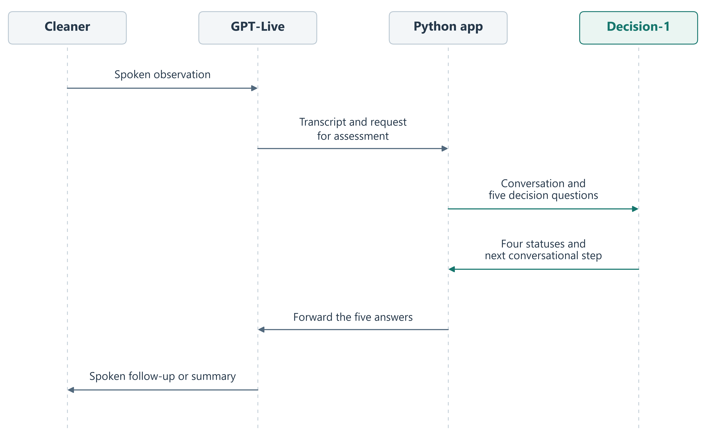
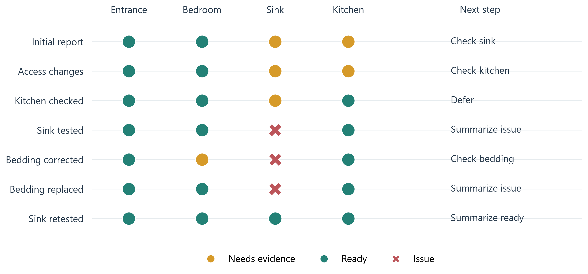

# Let Decision Models Guide Your Voice Assistant

A tutorial connecting Azure GPT-Live to Microsoft Decision-1. GPT-Live handles the spoken conversation; Decision-1 assesses four inspection requirements and selects the next conversational step. Python passes the conversation and returned choices between them.

Start with [voice_inspection.ipynb](voice_inspection.ipynb).



## Setup

Use Python 3.11 or later. Create a virtual environment, activate it, then install the dependencies:

```bash
python -m venv .venv
# Windows PowerShell:
.venv\Scripts\Activate.ps1
# macOS / Linux: source .venv/bin/activate
python -m pip install -r requirements.txt
```

Open the notebook in VS Code or your preferred Jupyter environment and select this virtual environment as the kernel. The dependencies include the Python kernel; install a Jupyter frontend separately if needed.

## Explore the saved conversation

Run the notebook cells to display the recorded transcripts, selected decisions, and assistant audio. This uses the included files and makes no model calls or microphone recordings. No credentials are needed for the saved walkthrough.

The scenario has seven scripted synthetic cleaner updates. The assistant replies and decisions are actual outputs from GPT-Live and Decision-1. It follows changes in room access, a sink leak, a corrected bedding report, and a final successful retest.



## Use your Azure deployments

Copy `.env.example` to `.env` and fill in:

- `AZURE_ENDPOINT`: your shared Azure Foundry resource endpoint.
- `AZURE_API_KEY`: your resource key.
- `AZURE_DECISION_DEPLOYMENT`: your Decision-1 deployment name.
- `AZURE_LIVE_DEPLOYMENT`: your GPT-Live deployment name.

The example defaults are `Decision-1` and `gpt-live-1`. The notebook uses the native Decision API and GPT-Live client delegation over WebSocket. It does not require a direct OpenAI account.

To try a fresh decision request, uncomment the optional call beneath the recorded conversation. To talk to the assistant, use headphones and uncomment:

```python
live_result = await inspect_property(seconds=120)
```

Run this on a local machine with microphone and speaker access. These optional calls use your Azure deployments and incur their normal charges. The microphone adapter is included; the recorded demonstration exercised synthetic audio rather than human microphone input.

## Files

- `voice_inspection.ipynb`: implementation, recorded walkthrough, and optional microphone interaction.
- `results/voice_run.json`: all seven actual input/output transcripts and model decisions.
- `audio/cleaner_*.wav`: scripted synthetic input speech.
- `audio/assistant_*.wav`: generated assistant audio from the same session.
- `results/voice_decision_sequence.*`: architecture diagram, in PNG and SVG.
- `results/status_timeline.*`: requirement statuses and next steps across the conversation, in PNG and SVG.

## Adapt the pattern

Start with the four requirements in `CHECKS`, then adjust the shared evidence policy and next-step choices. Every assessment sends five questions in one request. The app forwards the selected labels unchanged, and GPT-Live phrases the response.

`finish` means the assessment is determined, including any known problems; it does not mean every requirement passed.

API documentation: [Microsoft Decision-1](https://learn.microsoft.com/en-us/azure/foundry/foundry-models/how-to/use-foundry-models-microsoft-decision), [Azure GPT-Live](https://learn.microsoft.com/en-us/azure/foundry/openai/how-to/gpt-live), and [client delegation](https://learn.microsoft.com/en-us/azure/foundry/openai/how-to/gpt-live-delegation).
